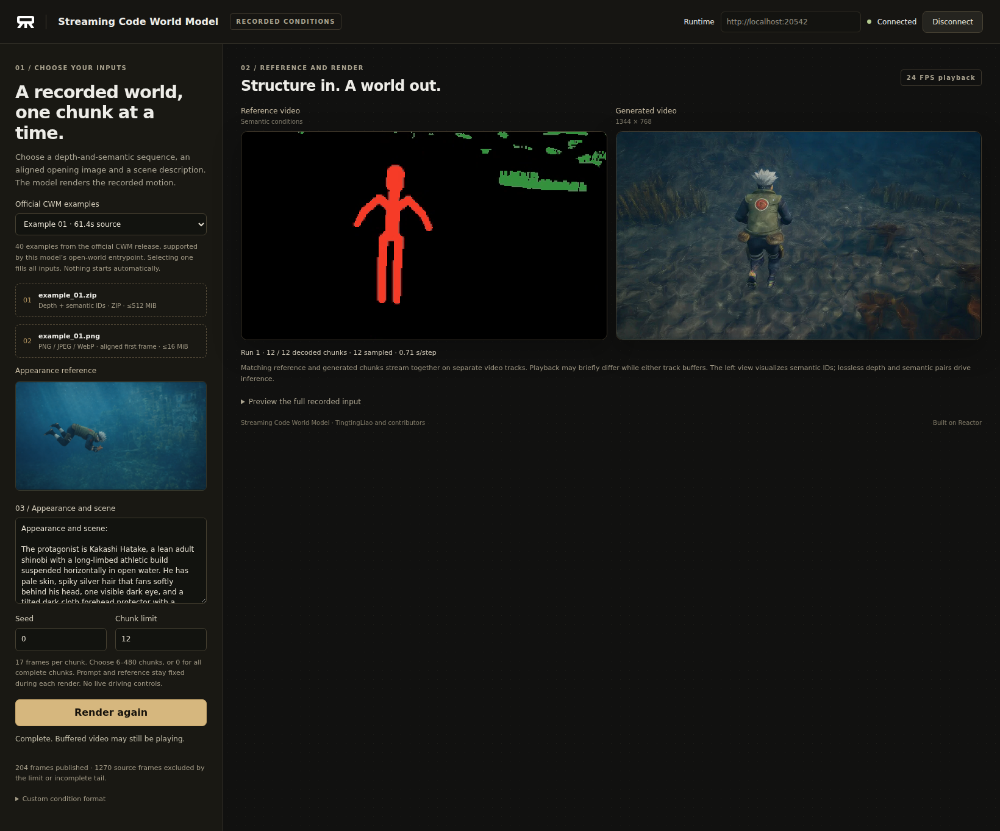

# Streaming Code World Model on Reactor

Render recorded worlds with [Streaming Code World Model](https://github.com/TingtingLiao/streaming-code-world-model), powered by [Reactor](https://reactor.inc). Choose a recorded depth-and-semantic sequence, its opening reference image and a scene description. Generated video arrives one chunk at a time in the included browser demo.



What this integration adds:

- A Reactor service launched with `reactor build` and `reactor run`.
- A small browser client with 40 paired CWM examples, custom inputs, progress, and explicit Start/Stop controls.
- Separate reference and generated video panels, with the appearance-image preview below input 02. Matching semantic frames accompany each generated chunk on a second video track.
- Streaming inference using the released four-step DMD checkpoint, BF16 transformer and six-chunk sliding history. The original sampling order, KV updates and RoPE rotation are preserved.
- A native single-GPU reference path and an optimized FA4 path on one, four or eight B200s, with Runtime-managed workers.

## What you need

- Linux, Docker, the [NVIDIA Container Toolkit](https://docs.nvidia.com/datacenter/cloud-native/container-toolkit/latest/install-guide.html), and four NVIDIA B200s for the default configuration. One- and eight-GPU configurations are supported below. Multi-GPU measurements use a single NVLink-connected node.
- At least 256 GB of host RAM; allow 512 GB for multi-GPU loading. The text encoder resides on CPU between renders. Weight loading temporarily uses more GPU memory than steady-state rendering; use free cards with sufficient headroom.
- Approximately 126 GiB for the downloaded weights and expanded examples, plus space for Docker layers, download caches and browser assets.
- Python 3.12 for preparing browser assets, and Node.js 20+ with npm for the client.

Run the following commands from this directory, alongside `reactor.yaml`.

## 1. Install the Reactor CLI

```sh
brew install reactor-team/tools/reactor-cli
```

For Linux without Homebrew, use the [CLI installation guide](https://docs.reactor.inc/deploy/platform/installation). **Check:** `reactor version` prints a version.

## 2. Start the model

```sh
reactor validate
reactor build
reactor run --gpus '"device=0,1,2,3"' --port 8080 --weights ./weights
```

Choose free GPUs on shared machines. The first start downloads the pinned MiniMax-H3 components, Qwen processor, released streaming DMD LoRA and the 40-example CWM dataset into the mounted weights directory. Later starts reuse those files. A read token can be forwarded with `-e HF_TOKEN` when needed; keep credentials out of source files.

Loading the model takes several minutes after downloading. Leave this terminal running; `Ctrl+C` stops the container. Rebuild after changing the adapter or manifest.

**Check:** in another terminal, wait for `"state":"available"`:

```sh
curl -s http://localhost:8080/health
```

Docker image storage and model weights are separate. Configure the Docker data directory and use `--weights /path/to/large-volume/weights` if the system disk is small; use that same weights directory in the next step.

### Choose the inference configuration

Set `num_gpus` and `inference_mode` in `streaming_cwm.yaml`, and set `model.resources.gpu.count` in `reactor.yaml` to the same GPU count **before rebuilding**. Expose exactly that many devices to `reactor run`:

| Configuration | `num_gpus` | `inference_mode` | GPU selection example |
| --- | --- | --- | --- |
| Native reference | 1 | `native` | `--gpus device=0` |
| FA4, single GPU | 1 | `fa4` | `--gpus device=0` |
| FA4, default | 4 | `fa4` | `--gpus '"device=0,1,2,3"'` |
| FA4, eight GPUs | 8 | `fa4` | `--gpus all` |

`DistributedRunner` owns device assignment, process groups and worker shutdown. The model uses tensor parallelism across complete attention heads and MLP channels; VAE tiles are also distributed. FA4, cached AdaLN projections, fused modulation/RoPE, packed KV reads and CUDA-graph VAE decoding reduce inference overhead. These paths retain four denoising steps, the six-chunk history and the original precision policy; they do not use FP8 or shorten the context.

## 3. Prepare the example gallery

After the service has materialized the examples, create their browser previews from the same files. This preparation uses CPU only:

```sh
python3.12 -m venv .venv
. .venv/bin/activate
pip install numpy Pillow av
python prepare_examples.py --release-root ./weights
```

**Check:** `demo/public/examples/index.json` contains 40 entries. The generated previews and condition archives are ignored by Git. The model reads built-in conditions directly on the server; selecting a built-in example does not send its large archive through your browser.

## 4. Open the client

In another terminal, from this directory:

```sh
cd demo
cp .env.example .env
npm ci
npm run dev
```

Open **http://localhost:3000**, set **Runtime** to your service's HTTP address, click **Connect**, choose an **Official CWM example**, and click **Start rendering**. Choosing an example fills its conditions, reference and prompt together. Selecting or uploading inputs alone never starts generation. No example is selected automatically.

Edit **Runtime** while disconnected to choose a different address or port, then click **Connect**. Links can prefill it with `?endpoint=http%3A%2F%2Flocalhost%3A8080`. Otherwise, its initial value comes from `VITE_REACTOR_URL` in `demo/.env`, falling back to `http://localhost:8080`; restart the frontend only when changing that default.

The left panel shows the semantic reference sequence; the right shows generated video. Both tracks publish the same 17-frame intervals at 24 FPS, starting at frame zero. References wait for their matching decoded output, including the final decoder flush. They also work for custom ZIP uploads. The tracks have independent browser buffers, so a temporary playback offset is possible; this is not an atomic left/right frame guarantee. **Preview the full recorded input** opens a separate inspection player. The appearance reference stays below input **02**.

### Remote GPU machines and SSH

The browser needs both the HTTP endpoint and a WebRTC media path. SSH port forwarding carries TCP; forwarding the HTTP port alone does not carry WebRTC UDP. Docker host networking alone does not solve this either. Configure an authenticated TURN-over-TCP relay reachable by the browser and model, advertise it through Runtime's ICE configuration, and forward its TCP port along with the frontend and HTTP ports. Keep relay credentials and machine-specific network settings outside this repository. See [the demo guide](demo/README.md).

## Inputs and controls

| Control | Effect |
| --- | --- |
| Official CWM example | Select one of 40 recorded sequences with its paired opening image and static prompt. |
| Conditions ZIP | Upload lossless depth/semantic-ID pairs, up to 512 MiB. |
| Reference image | Upload an aligned first frame: PNG, JPEG or WebP, up to 16 MiB. |
| Appearance and scene | Describe the initial appearance. The prompt remains fixed for this render. |
| Seed | Seed for a fresh render, from 0 to 2147483647. |
| Chunk limit | Render 6–480 complete chunks, or use 0 for all available complete chunks up to 480. |
| Start rendering / Render again | Begin a fresh run with the selected inputs. |
| Stop rendering | Stop at the next step boundary, clear queued video and release this run's caches. |

The released open-world path uses a static caption and removes any `Protagonist action timeline:` section. This integration follows that behavior. Choose new text before starting a fresh render. Live prompt editing, live driving and CARLA simulation are outside this recorded-input version.

### Custom condition format

The ZIP contains consecutive pairs, beginning at frame zero, directly at its root or under `conditions/`:

```text
000000.depth.f32
000000.semantic_id.png
000001.depth.f32
000001.semantic_id.png
...
```

Depth files are **336 × 192 little-endian float32 distances in metres**. Semantic files are **336 × 192 grayscale PNGs with class IDs 0–11**, using the original [CWM condition convention](https://github.com/buaacyw/code-world-model). At least 102 frames are required. Pair them with an aligned opening image and scene prompt; the reference is fitted to 1344 × 768 using the native resize. Unsupported, missing, duplicate or unsafe files are rejected before replacing the current run. Expanded archives are limited to 3 GiB.

An ordinary RGB or colour-semantic MP4 does not retain the required depth and semantic-ID data. The MP4 displayed by the gallery is a preview, while the service consumes the lossless pairs. Incomplete final chunks and frames excluded by your limit are reported in the UI.

## Streaming and timing

Each sampling call generates **five latents / 17 frames**. The native decoder uses two latents of lookahead and a five-frame boundary blend, so the first video chunk arrives after the second sampling step. Later calls publish one 17-frame chunk; a final decode-only step flushes the last chunk. The service does not wait for the entire video to finish.

Playback/export follows the native **24 FPS** timing. The player can pause between chunks when generation is slower. The initial step also encodes all selected conditions and text; this preparation takes longer than subsequent steps. Reducing the chunk limit shortens input preparation without shortening the six-chunk model history.

The `native` B200 compatibility path selects the upstream PyTorch SDPA attention option, including the token refiner; masked prefill retains upstream FlexAttention. Keep this mode when an exact reference comparison is required. FA4 kernels and tensor-parallel reduction order can change floating-point results; the optimized modes are not bitwise-equivalent to the single-GPU reference.

## Validation

A fixed-seed, fixed-prompt comparison on one B200 ran the original sampler and the adapter for **12 consecutive chunks / 204 frames**, spanning KV-window eviction and RoPE rotation. Generated latents and decoded RGB arrays matched exactly: maximum absolute difference **0** for both. The comparison used identical prepared inputs and the same B200-compatible attention settings; it does not establish equality for every input, device or lossy encoded video.

The packaged `reactor run` service was tested on four and eight NVLink-connected B200s at 1344 × 768. Both configurations completed **12 consecutive chunks / 204 frames** for official example 01 and a custom upload of example 02, followed by two disconnect/reconnect cycles. Four-GPU measurements cover generated-video transport; eight-GPU measurements cover both reference and generated tracks. Approximate warm generation rates were:

| Configuration | Official example 01 | Custom upload, example 02 |
| --- | ---: | ---: |
| FA4, four GPUs | 17.68 FPS | 18.58 FPS |
| FA4, eight GPUs | 26.56 FPS | 27.72 FPS |

These two-input measurements use Runtime step times displayed to 0.01 seconds for sampled chunks 7–12, after the six-chunk window fills. They include sampling, VAE decoding and worker IPC, and exclude model loading, input preparation, cold compilation, WebRTC encoding/network and browser playback. They are representative runs rather than a repeated benchmark. The first step took 79–82 seconds on four GPUs and 91–93 seconds on eight; first video arrives one sampling step later. Shared-card contention can lower throughput. Browser playback remains the original **24 FPS**.

Earlier optimization experiments measured 2.48 FPS for the native single-GPU reference, 5.97 FPS for single-GPU FA4, and 26.43 FPS across three warm eight-GPU trials. Those experiments compared FA4 against the corresponding unoptimized multi-GPU baselines over 204 decoded frames: mean absolute RGB difference was **5.46/255 on four GPUs** and **3.98/255 on eight GPUs**. These numerical comparisons predate the final packaged-service tests; no new raw-RGB FA4 comparison was made during those service tests. The exact-zero result above applies only to the native single-GPU reference under the stated conditions.

The production browser bundle also passed Stop, invalid-upload recovery, editable Runtime endpoint switching and relay-only TURN/TCP video checks. These tests cover representative inputs; all 40 examples have been checked for input preprocessing, not exhaustively generated on GPU.

The CPU suite passed 60 tests with two CUDA-only skips in the installed model environment. It exercises real Runtime hooks, source acknowledgement, refusal, error propagation, session cleanup, model-half reset, exact reference-frame indices, staged-input lifetime, example selection and upload validation:

```sh
pip install reactor-runtime==3.8.3 numpy Pillow pytest
pytest -q tests
```

Tests requiring upstream model packages are skipped when those packages are absent. With the model environment installed, the suite also checks distributed preparation failure, all-rank decode cadence, tensor-parallel cache rollover and native attention-prefix semantics. Fused-kernel equality checks require CUDA.

## More

- [Reactor Runtime](https://github.com/reactor-team/reactor-runtime) and [SDK documentation](https://docs.reactor.inc/sdk-reference/using-the-sdk).
- `GET /schema` describes `start`, `start_example`, `stop`, the `state_update` broadcast and the `main_video` / `reference_video` tracks. The included client uses the official JavaScript SDK in local mode. Hosted authentication requires a backend token exchange.
- `streaming_cwm.py` owns commands, session state and Runtime hooks. Its `generate()` forwards a frozen CPU input to `DistributedRunner`. `streaming_cwm_model.py` owns run identity; the selected backend owns weights, conditioning and caches; `streaming_cwm_sampling.py` exposes the native chunk boundary and incremental decoder. The model half imports no Runtime APIs.
- `reactor.yaml` pins Runtime and the three upstream source revisions. Build installs those sources and applies CWM's own required Musubi patches. Native training/inference files in this checkout remain unchanged.

## Credits and usage terms

Thanks to [Rising0321](https://github.com/Rising0321) for porting Streaming Code World Model to Reactor. The model, training and released inference implementation are the work of Tingting Liao, Guangyi Liu and the upstream contributors, building on CWM, MiniMax-H3, Musubi, CARLA and Qwen3-VL.

Model weights and dependencies retain their respective usage terms. The pinned Streaming Code World Model repository and LoRA model card do not declare an explicit licence; confirm redistribution and deployment permission with their authors before publishing or deploying a derivative. This integration does not grant rights to those assets.
